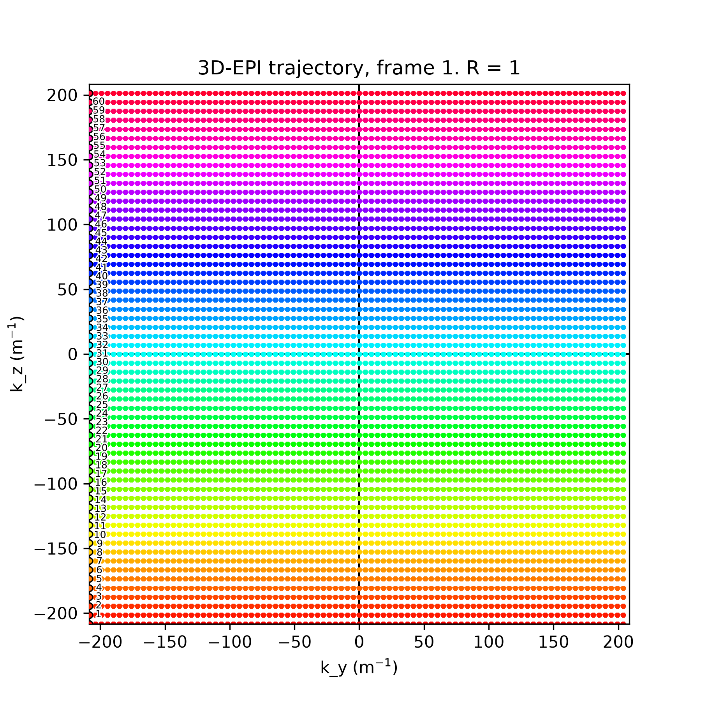
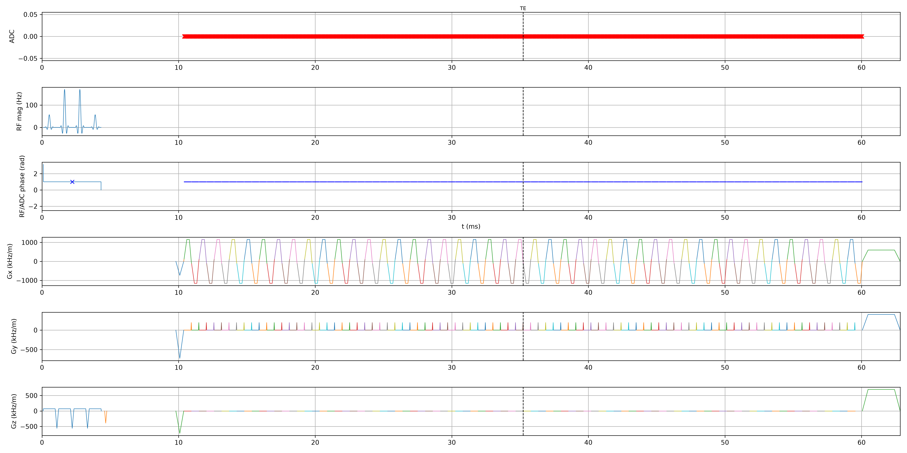
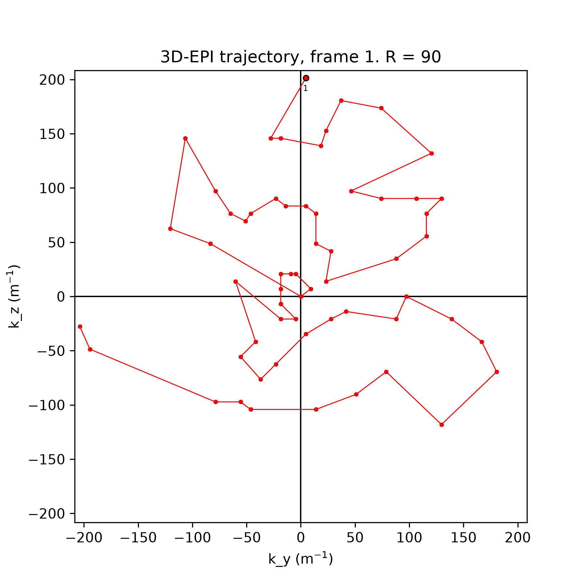
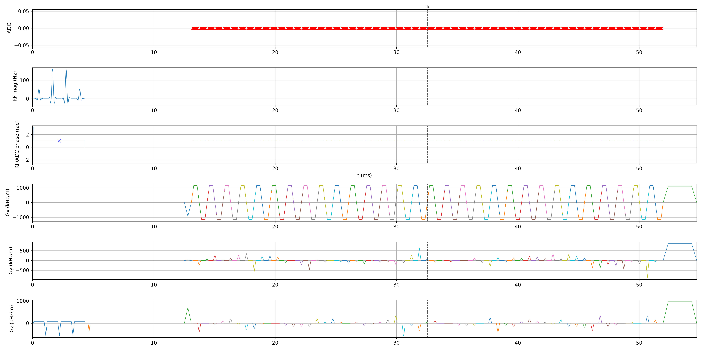
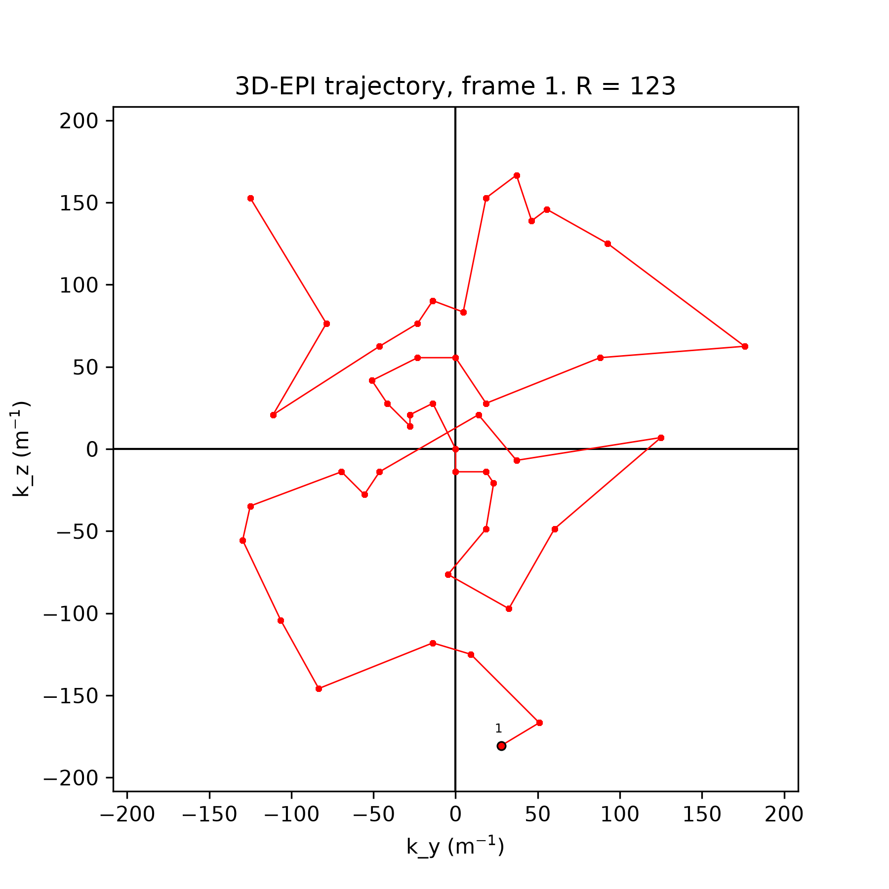
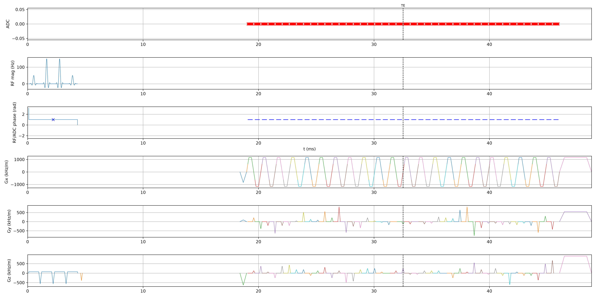
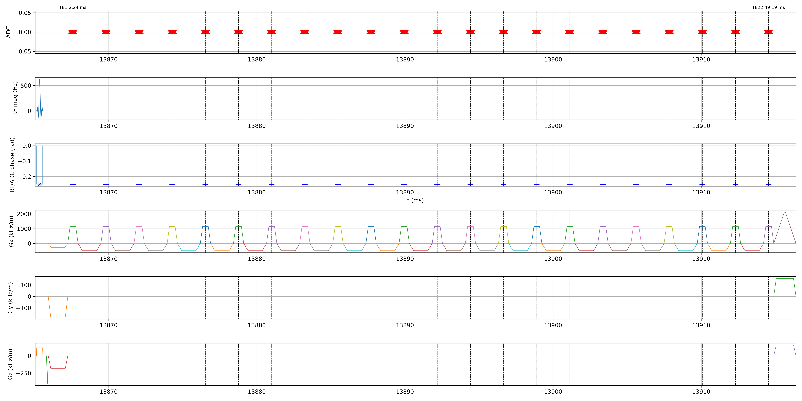

# 2026-11-12 comet session — sequence summary

Sequences for the three items the collaborator requested, built 2026-11-11 and revised 2026-11-12 with
ArbEPI-python `main` (28a28fa, unmodified; fetched and up to date) by `generate.py` in this folder. Protocol for
every EPI: 90 x 90 x 60 matrix, 2.4 mm isotropic, FOV 216 x 216 x 144 mm, GE_MR750, water excitation (no
fat-sat), human PNS weights, no discard frames, 5 min (`Nframes = ceil(300 s / frame TR)`), **4 µs ADC dwell**
for all three. Every file is under the 80 % normal-mode PNS limit (`generate.py` refuses to export above it).
The `.pge` files were copied to the inside scanner with `ge/coppe.py` (entry numbers 266-275, see "Scanner transfer").

| Folder | Request | Trajectory | Sampling | ETL x Nshots | R | TE of k = 0 | Frame TR | Nframes (scan) | Flip | Dwell | Peak PNS ArbEPI / EPIcal | Acoustics ArbEPI / EPIcal (limit 0.3) |
|---|---|---|---|---|---|---|---|---|---|---|---|---|
| `1_laminar_1x_2.4mm_ETL90` | 1 | laminar, one ky line per train | fully sampled | 90 x 60 | 1 | **33.301 ms** | 62.830 ms/shot, 3.7697 s volume | 80 (301.6 s) | 17.67° | 4 µs | 69.6 % / 69.6 % | 0.090 / 0.089 |
| `2_radial_90x_2.4mm_ETL60` | 2 | radial, one train per frame | `mask_60`, 60 samples | 60 x 1 | 90.0 | 30.002 ms | 54.744 ms | 5481 (300.1 s) | 16.51° | 4 µs | 76.5 % / 74.7 % | 0.039 / 0.040 |
| `3_radial_122.7x_2.4mm_ETL44` | 2 | radial, one train per frame | `mask_44`, 44 samples | 44 x 1 | 122.7 | 30.000 ms | 48.844 ms | 6143 (300.0 s) | 15.61° | 4 µs | 76.7 % / 73.3 % | 0.044 / 0.045 |
| `4_meGRE_dwell4us` | 3 | monopolar multi-echo GRE | Cartesian 90 x 90 x 60 | 22 echoes, 1 excitation/(ky,kz) | -- | TE 2.236 ... 49.192 ms | 51.35 ms | 291.2 s | 16.0° | 4 µs | 71.6 % | 0.155 |

Folders 1-3 hold `ArbEPI`, `EPIcal`, `noise` (`.seq` + `.pge`), `scan_info.mat`, the diagnostic plots
(`mask.png`, `trajectory.png`, `psf.png`, `one_tr.png`, `PNS_one_tr.png`) and `build_info.json` (every
timing number). Folder 4 holds `meGRE.seq/.pge`, `meGRE_info.json` and `one_tr.png` (the first image
excitation: prephasers, 22 echoes with their centers marked, spoiler/rewinders). `logs/` has the build logs
(hardware / PNS / acoustics reports per file).

## Trajectories and sequence diagrams

For each EPI: the (ky, kz) trajectory of frame 1 (physical k-space, m^-1; the start of the echo train is marked
and the line connects consecutive echoes), and the first TR (RF, ADC and the three gradient axes, time in ms).
The dashed line in the TR diagrams is the repo's *nominal* TE marker (echo ETL/2 - 0.5), not the k = 0 echo; the
time of the k = 0 sample is in the table above (33.3 ms, 30 ms, 30 ms).

### 1_laminar_1x_2.4mm_ETL90: fully sampled, one ky line per train (frame = 60 trains)

Each color/number in the trajectory is one train: a ky line at one kz (60 trains per volume).





### 2_radial_90x_2.4mm_ETL60: R = 90, one train per frame (60 samples)





### 3_radial_122.7x_2.4mm_ETL44: R = 122.7, one train per frame (44 samples)





### 4_meGRE_dwell4us: first image excitation (22 echoes; dashed lines mark every echo center)



## Item 1 -- fully sampled laminar (`1_...`)

All-ones (ky, kz) mask, **ETL 90 = Ny, 60 shots**: each train is one full **ky** line (one kz, ky = 0..89 in
unit steps, the same direction every shot), kz ascending across shots; no kz blips, only ky blips of one step.
ArbEPI-python's own `mask2epi_laminar` does not give this (it fills each shot with consecutive samples of a
kz-outer / ky-center-out raster), so `generate.py` swaps in `mask2epi_ky_lines` through
`sequences.ArbEPI._MASK2EPI`; the repo is untouched. ky ascends in every train, so ky = 0 is on echo 45 of every
line; the k = 0 sample (kz = 0, shot 30, echo 45) is at **33.301 ms** after the RF center (measured from the
played k-space trajectory; prescribed 33.3 ms, 2 µs is the 4 µs block raster).

**Why TE 33.3 ms and not 30 ms.** At ETL 90, with k = 0 on echo 45, the time before the first echo is 3.4 ms (half
the water excitation, prephasers, dead times). At the 6 µs dwell the repo would pick, the earliest k = 0 echo is
at about 33.3 ms. At the 4 µs dwell it would be at about 27 ms, so 33.3 ms (your choice) is reached by delaying
the train by 6.3 ms. Volume TR is 60 x the minimum per-shot TR (62.83 ms), 3.77 s, so a 5-min scan has 80
volumes (301.6 s). Flip is the Ernst angle for the per-shot TR (17.7°).

**4 µs dwell and the coil's acoustic band.** ArbEPI's `find_min_feasible_dwell` rejects a dwell when the echo
spacing is within 20 µs of one of the coil's forbidden acoustic-resonance bands (`xrm`: 410-510 µs on x/y,
360-440 µs on z). At 4 µs and the default slews arm 1's echo spacing is 524 µs, 14 µs above the 510 µs band edge,
so the repo would have chosen 6 µs (660 µs); forcing 4 µs (`FORCE_DWELL` in `generate.py`, so that all EPIs share
one receiver bandwidth) passed the repo's acoustics check with **0.2995 of the 0.3 limit**, no margin. The
readout ramp-up slew was therefore lowered to 120 T/m/s (blip 200, fall 190), which moves the echo spacing to
552 µs, outside the repo's band margin (>= 530 µs): acoustics **0.090 / 0.089** of 0.3, peak PNS 69.6 %, at
+2 % per-shot TR (62.83 vs 61.60 ms). Chosen from a 12-point slew grid (`pns_search`-style, 1 frame, spoilers
at maximum): lower ramp slews gave lower acoustics, e.g. 100 / 100 / 100: 640 µs, 0.027, +8 % TR.

## Item 2 -- radial with the provided masks, one echo train per frame (`2_...`, `3_...`)

`mask_60.mat` (60 samples) and `mask_44.mat` (44 samples) are byte-identical to
`20260922xiaokai/seqs/mask_*.mat`. **Each frame is one echo train that traverses all samples of its mask**:
ETL 60 / 44, 1 shot, R 90.0 / 122.7, `epi_trajectory = 'radial'`. The frame TR is the minimum, 54.74 / 48.84 ms,
so there are 5481 / 6143 frames in 5 min (a 2-shot split into two 30 / 22-echo frames needed 90 / 84 ms per
pair). Flip is the Ernst angle (16.5° / 15.6°).

**Same echo order every frame.** The repo's current `main` chains the golden angle across frames, which makes
the order differ every frame. Here the repo's own `mask2epi_radial` is run once in its per-frame mode (`tau0 =
None`, the behavior of the 9/22 scans) with `Nshots = 1`, and that schedule is played on every frame
(`generate.py: use_arm` replaces `arb._compute_schedules`; no repo edit). `verify.py` checks that
`scan_info.mat`'s schedules, including echo times, are identical in all frames.

**k = 0 in every frame.** The provided masks contain no k-space center, (ky, kz) index (45, 30) (the index
ArbEPI's prephasers/blips treat as k = 0). `mask2epi_radial` puts the sample nearest the center on echo
`(ETL - 1) // 2` (29 for ETL 60, 21 for ETL 44); that sample is moved onto DC (your choice of 2026-11-11):
`mask_60`'s (46, 30) and `mask_44`'s (45, 29). Sample count, ETL and R are unchanged. Each frame plays k = 0
exactly once, so there is no duplicate (ky, kz) within a frame. **The collaborator should know each pattern
changed by one sample.** The edited sets are in `scan_info.mat` (`schedules`).

**TE.** ArbEPI-python's nominal TE sits at echo ETL/2 - 0.5, half an echo spacing off for even ETL, so TE is
prescribed so that the DC sample's own kx = 0 crossing is at 30 ms (`generate.py: design`). TE is counted from
the RF center that pulseq reports for the water-excitation pulse, the midpoint of the whole 1-3-3-1 train
(2.112 ms into the 4.222 ms pulse; the amplitude centroid is identical). Checked on a built copy of the first
frame (same timing as the full sequence) from the played k-space trajectory: the DC echo's kx = 0 crossing is
**30.002 ms / 30.000 ms** after the RF center, (ky, kz) = (0, 0) there to numerical precision. The residual is
the 4 µs block raster. The saved per-echo times (`scan_info.mat` `schedules(:,:,:,3)`) give the same for
every frame.

**Dead time.** With k = 0 on the middle echo of the train, TE 30 ms still needs a wait before the train:
7.8 ms (arm 2) and 13.7 ms (arm 3). Arm 3's train is shorter, so it waits more. Moving k = 0 later in the
train would remove it but would break the spoke (a long jump in the echo order); not done.

**Timing and PNS were measured on this schedule.** Blip step maxima: ky 25 / kz 12 (arm 2), ky 19 / kz 11
(arm 3). At the repo's default slews (blip / readout fall / readout rise = 200 / 190 / 155 T/m/s) both arms are
over or near the 80 % limit; slews were retuned with `pns_search.py` (coarse grid, 6 frames with every spoiler
at its maximum, PNS <= 79 %): arm 2 160 / 160 / 140, arm 3 180 / 140 / 140, among the fastest per-shot TRs on
that grid, picked for margin among near-ties. The real builds measure 76.5 % and 76.7 %. Arm 1 is at the
defaults. The dwell is 4 µs for both radial arms (the repo's own choice).

## Item 3 -- multi-echo 3D GRE (`4_...`)

`sequences/meGRE.py` (monopolar, one excitation reads 22 flyback-monopolar echoes per (ky, kz)), with the
EPIs' FOV 216 x 216 x 144 mm, 2.4 mm isotropic, and their **4 µs ADC dwell (250 kHz receiver bandwidth)**, the
same for all three EPIs, so there is one meGRE. Echoes sit at multiples of the fat off-resonance period
(1/f_fat = 2.236 ms at 3 T, `TE_n = n / f_fat`, fat in phase with water): the first at 1 x 2.236 ms (the
earliest multiple the prephasers fit in), up to the 22nd at 49.19 ms (a 23rd would be 51.4 ms > 50 ms). The
1-excitation-per-(ky, kz) scan (5670 shots including 2 dummy z-loops and the receive-gain block) takes 291 s.
No deGRE was built (the repo still labels meGRE a prototype; a dual-echo `deGRE` can be added as in
`20260922xiaokai/seqs/5_deGRE` if a fallback is wanted). Each EPI folder's `scan_info.mat` carries the
matching meGRE `*_degre` keys (Nx/Ny/Nz, fov, n_echoes, 22 echo times, TR, flip, dwell), so preprocessing reads
them as a deGRE (`main.py --gre megre` equivalent). `one_tr.png` shows the first image excitation (iZ = 1,
iY = 0) after the dummy z-loops and the receive-gain block, with every echo center marked. The readout is
27.2 mT/m (PNS 71.6 %, acoustics 0.155 of the 0.3 limit). `meGRE.seq` reaches 49.93 mT/m (limit 50), which is a
gradient other than the readout.

## Hardware (`logs/`)

| File | max grad (limit 50 mT/m) | max slew (limit 200 T/m/s) | max B1 (limit 0.25 G) |
|---|---|---|---|
| `1_.../ArbEPI` | 27.18 | 188.8 | 0.0400 |
| `2_.../ArbEPI` | 27.65 | 158.0 | 0.0373 |
| `3_.../ArbEPI` | 27.39 | 177.1 | 0.0353 |
| `4_meGRE_dwell4us` | 49.93 | 174.3 | 0.1468 |

## Running at the scanner

This is a suggested order, not something the collaborator specified. It follows the 9/22 session
(`20260922xiaokai/series_description.txt`: GRE, then per EPI configuration a calibration scan, a noise scan and
the EPI runs) and the repo's pipeline (noise -> whitening, EPIcal -> readout delay and odd/even phase, meGRE ->
coil compression, sensitivity maps and B0).

1. **Transfer** (done, 2026-11-12): the `.pge` files are on the inside scanner; type the entry number from the
   table below into the User CVs of a pge2 prescription (see `ge/README.md` in ArbEPI-python, "Running the sequence on
   the scanner console").
2. **Localizer / anatomical** as usual (not part of these sequences).
3. **`4_meGRE_dwell4us/meGRE`**, once. It is shared by all three EPIs (same FOV, resolution and 4 µs dwell) and
   takes 291 s.
4. **For each EPI folder, in the order 1, 2, 3:** `EPIcal`, then `noise`, then `ArbEPI` (5 min, one run: 80 / 5481 /
   6143 frames). Use the same folder's three files together; each folder's `scan_info.mat` goes with its `ArbEPI`
   data in preprocessing.
5. **Prescription.** Prescribe the same FOV / slab position for every scan (216 x 216 x 144 mm; the 9/22 session had
   a calibration scan that had to be discarded because the FOV was not prescribed).
6. **Data.** Raw ScanArchives go in `../scanarchives/`; note each Series number in the table below.

Series log of the 2026-11-12 ball-phantom session (Series numbers verified from each ScanArchive's readout
count and length; entry numbers are the pge2 User CV values):

| Order | Scan | File | Entry # | Series |
|---|---|---|---|---|
| -- | localizer | product | -- | 1 |
| -- | prescan (1 coil) | -- | -- | 29000 |
| -- | MPRAGE | product | -- | 2 |
| 1 | meGRE (shared) | `4_meGRE_dwell4us/meGRE` | 275 | 3 |
| 2 | calibration | `1_laminar_1x_2.4mm_ETL90/EPIcal` | 267 | 4 |
| 3 | noise | `1_laminar_1x_2.4mm_ETL90/noise` | 268 | 5 |
| 4 | EPI | `1_laminar_1x_2.4mm_ETL90/ArbEPI` | 266 | 6 |
| 5 | calibration | `2_radial_90x_2.4mm_ETL60/EPIcal` | 270 | 7 |
| 6 | noise | `2_radial_90x_2.4mm_ETL60/noise` | 271 | 8 |
| 7 | EPI | `2_radial_90x_2.4mm_ETL60/ArbEPI` | 269 | 9 |
| 8 | calibration | `3_radial_122.7x_2.4mm_ETL44/EPIcal` | 273 | 10 |
| 9 | noise | `3_radial_122.7x_2.4mm_ETL44/noise` | 274 | 11 |
| 10 | EPI | `3_radial_122.7x_2.4mm_ETL44/ArbEPI` | 272 | 12 |

The raw data (a ball phantom, not a human subject) is in `../scanarchives/Series<N>/`; every noise Series holds a
small ~2 MB prescan archive next to the real noise archive. Reconstruction output goes in `../recon/`.

## Reproduce

```
cd /home/rexfung/github/ArbEPI-python        # main, 28a28fa
.venv/bin/python /StorageRAID/rexfung/20261112comet_ball/seqs/pns_search.py radial_mask60  # slews (LIMIT=79 env); also radial_mask44
.venv/bin/python /StorageRAID/rexfung/20261112comet_ball/seqs/generate.py build           # folders 1-3 (all arms or named)
.venv/bin/python /StorageRAID/rexfung/20261112comet_ball/seqs/generate.py megre           # folder 4 (with one_tr.png)
.venv/bin/python -I /StorageRAID/rexfung/20261112comet_ball/seqs/verify.py                # checks scan_info.mat
```
`generate.py measure [arm]` (arms laminar_1x, radial_mask60, radial_mask44) prints each arm's timing without
building anything.

## Not done / flagged

* **Arm 1 is on a forced 4 µs dwell** (the repo's own choice would be 6 µs); see Item 1 for the acoustics margin.
* **Scanner transfer** (2026-11-12, `ge/coppe.py --target inside`, run id `20261112comet`, run from a staging folder of
  uniquely named copies of the `.pge` files, since coppe takes one folder and every folder here has `ArbEPI.pge`,
  `EPIcal.pge`, `noise.pge`). Files are in `/srv/nfs/psd/usr/psd/rexfung/20261112comet/` on the scanner:

  | Folder | ArbEPI | EPIcal | noise | meGRE |
  |---|---|---|---|---|
  | `1_laminar_1x_2.4mm_ETL90` | 266 | 267 | 268 | |
  | `2_radial_90x_2.4mm_ETL60` | 269 | 270 | 271 | |
  | `3_radial_122.7x_2.4mm_ETL44` | 272 | 273 | 274 | |
  | `4_meGRE_dwell4us` | | | | 275 |

  Re-running coppe with the same run id would prompt before overwriting these entries.

* `recon/` (one level up) is empty. No human subject was scanned this session, only a ball phantom.
* Items you may want to revisit: frame TR is the fastest per arm, no warm-up frames are discarded
  (`discard_duration = 0`), item 1's shots run kz ascending and echoes ky ascending.
